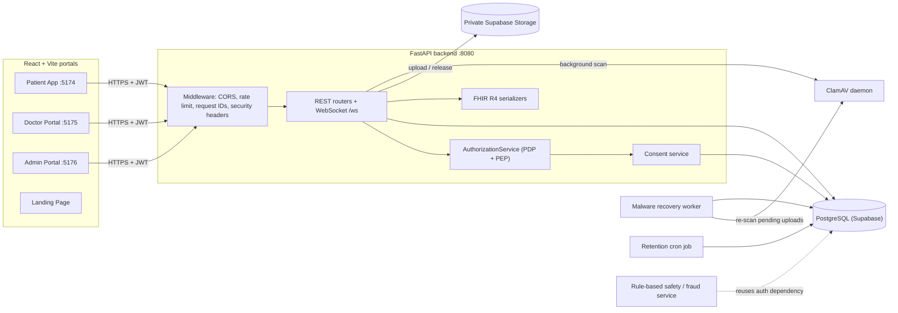

# MedFlow Guardian

A patient-controlled medical record platform where every view of a clinical document is checked against the patient's consent, then logged for audit.


## Overview

Medical records are spread across hospitals, and moving the right record to the right clinician is usually either too hard (records get re-requested on paper) or too loose (anyone in the system can see everything). MedFlow Guardian puts the patient in control of that flow. The guiding rule is **right data, right party, right purpose, right time**, and the project's main goal is to make that rule enforceable in code instead of leaving it as a UI promise.

The core scenario:

1. A doctor at **Hospital A** uploads a report for a patient.
2. The patient sees the report in their personal vault.
3. A doctor at **Hospital B** asks for access to that report.
4. The patient approves access for a limited time.
5. Hospital B can open the report until the grant expires or the patient revokes it. After that, access is denied immediately.
6. Every upload, view, grant, denial and revocation is written to an audit log.

The project began as a 2026 healthcare hackathon prototype and was then hardened step by step (central authorization, consent policy versioning, FHIR R4 interoperability, malware quarantine, production deployment). The phase reports are in [`docs/`](docs/).

> **Disclaimer:** This platform is for demonstration. It does not claim real hospital or EMR integration, real medical-device integration, trained medical AI, or actual regulatory (HIPAA/GDPR) compliance. Triage and "AI" checks are deterministic rules, not clinical models.

## Key features

| Area | What is implemented |
|---|---|
| **Consent enforcement** | Patient consents with immutable, versioned policies and append-only lifecycle transitions. Validity periods include the start time and exclude the end time. Every governed request is checked against the latest consent state. |
| **Time-boxed access grants** | Clinicians request access to a patient's documents. Patients approve or reject; approvals expire on their own and can be revoked at any time. Revocation pushes an `access_revoked` event over the WebSocket. |
| **Central authorization (Model A)** | The FastAPI backend is the only place where access is decided and enforced. `AuthorizationService` checks actor, organization, doctor-patient relationship, data, purpose, operation and validity on every protected request. |
| **Secure documents** | Files go to a private Supabase Storage bucket. Each upload is quarantined until ClamAV (INSTREAM protocol) explicitly reports it clean. If the scanner is unavailable, the document stays quarantined. |
| **Audit trail** | Authorization decisions are audited together with their request, correlation, consent-state and policy-version IDs. If the audit write fails, the document is not released. |
| **Authentication** | JWT access tokens kept in memory, rotating HttpOnly refresh cookies with replay detection, optional TOTP MFA, and an OIDC federation flow ([ADR-001](docs/adr/ADR-001-OIDC-FEDERATION.md)). |
| **FHIR R4 interoperability** | CapabilityStatement, `Consent` import/export, patient export Bundles and `Binary` documents. CI checks them against the official HL7 validator. |
| **Clinical workflow** | Visits, appointments, prescriptions, lab results, clinical notes, patient vital readings and patient-clinician messaging. |
| **Triage queue** | Patients submit symptoms. A deterministic keyword engine ([`triage_engine.py`](backend/app/ai/triage_engine.py)) assigns a review priority and always shows a "not a diagnosis" disclaimer. |
| **Privacy operations** | Patient privacy requests, admin decisions, legal holds, and a scheduled retention job. |
| **Admin platform** | Organization (hospital) management, staff membership, platform dashboard and audit views. |
| **Rule-based safety layer** | A separate, authenticated FastAPI service ([`backend/ai/`](backend/ai/)) that checks prescriptions for duplicate medications, allergy conflicts and drug interactions, and flags fraud patterns such as doctor shopping. |
| **Operations** | `/health` and `/ready` probes, a token-protected Prometheus `/internal/metrics` endpoint, structured logs with request IDs, Grafana dashboard and alert rules in [`ops/observability/`](ops/observability/). |

## Architecture



| Component | Responsibility |
|---|---|
| **Patient App** ([`patient-app/`](patient-app/)) | Dashboard, documents vault, access requests and history, consent policies, clinical history, appointments, notifications, profile and MFA. |
| **Doctor Portal** ([`doctor-portal/`](doctor-portal/)) | Triage queue, patients, patient details, report upload, access-control requests, appointments, notifications. |
| **Admin Portal** ([`admin-portal/`](admin-portal/)) | Organizations, staff, platform audit and settings. |
| **Landing Page** ([`landing-page/`](landing-page/)) | Public marketing page explaining the product. |
| **Shared UI** ([`frontend-shared/`](frontend-shared/)) | Shared Tailwind preset, UI primitives and API contract types used by the portals. |
| **Backend API** ([`backend/app/`](backend/app/)) | FastAPI app with about 85 endpoints across auth, access, consent, documents, clinical, triage, FHIR, privacy, admin and WebSockets. |
| **AuthorizationService** ([`backend/app/services/`](backend/app/services/)) | Collocated policy decision and enforcement point. It loads the latest consent state and policy version from PostgreSQL and records them in audit evidence. |
| **PostgreSQL** | All application data, managed by SQLAlchemy and Alembic migrations ([`backend/alembic/versions/`](backend/alembic/versions/)). Browser database roles get no direct table access; the API is the only way in. |
| **Supabase Storage** | Private bucket for medical documents. Only the backend releases a file, and only after authorization and a clean scan. |
| **ClamAV + malware worker** | Each upload is scanned as a background task. [`malware_worker.py`](backend/app/workers/malware_worker.py) picks up uploads that are still pending after a restart. |
| **Retention cron** | [`scripts/apply_retention.py`](backend/scripts/apply_retention.py) applies the retention policy (dry run by default, `--apply` to commit). |

## How it works

A typical cross-hospital document request goes like this:

1. **Login.** `POST /api/auth/login` checks the password (and TOTP if MFA is enrolled). It returns a short-lived access token and sets a rotating refresh cookie.
2. **Upload.** A Hospital A doctor calls `POST /api/documents`. The authorization service confirms hospital membership and an assigned visit or relationship. The file goes to private storage with `scan_status = pending`, and a background task streams it to ClamAV.
3. **Scan.** ClamAV returns `OK` or `FOUND`, and the document becomes `clean` or `malicious`. A timeout or unavailable scanner sets `scan_error`. Only `clean` documents can ever be released.
4. **Request.** A Hospital B doctor calls `POST /api/access-requests`. The patient is notified through the notifications API and WebSocket.
5. **Consent decision.** The patient approves with `POST /api/access-requests/{id}/approve`. This creates a time-limited grant tied to a versioned consent state.
6. **Release.** On `GET /api/documents/{id}/download`, the backend checks actor, organization, relationship, purpose, operation, consent state and validity window, then the scan status. An audit row is written *before* the bytes are streamed. If the audit write fails, the release is denied.
7. **Revocation.** `POST /api/access-grants/{id}/revoke` ends access immediately. Later requests are denied and audited, and connected clients receive an `access_revoked` WebSocket event.
8. **Interoperability.** The same consent and patient data can be exported as FHIR R4 resources (`/api/interoperability/...`). FHIR `Consent` resources can be imported, and anything unsupported is rejected.

## Tech stack

| Layer | Technologies |
|---|---|
| Backend | Python 3.11, FastAPI, Uvicorn, Pydantic v2, SQLAlchemy 2, Alembic, SlowAPI |
| Auth and crypto | PyJWT, passlib + bcrypt, PyOTP (TOTP MFA), `cryptography` (Fernet for MFA secrets), OIDC |
| Data and storage | PostgreSQL (Supabase-hosted), Supabase Storage (private bucket), psycopg2 |
| Security services | ClamAV (`clamd` INSTREAM), gitleaks, Dependabot |
| Frontends | React, TypeScript, Vite, Tailwind CSS, React Router, Axios, Recharts, lucide-react |
| Interoperability | HL7 FHIR R4, validated with the HL7 validator CLI in CI |
| Testing | pytest (unit, integration, security), Node test runner contract tests, Playwright (journeys, accessibility, visual), generated Postman collections |
| Deployment | Render blueprint ([`render.yaml`](render.yaml)): web service, malware worker, ClamAV private service, retention cron, three static sites |
| Observability | Prometheus-format metrics, Grafana dashboard, alert rules, structured JSON logs |

## Project structure

```text
medflow-guardian/
├── backend/
│   ├── app/
│   │   ├── main.py            # FastAPI app, middleware, router registration, health/metrics
│   │   ├── api/               # Route modules (auth, access, consent, document, clinical, fhir, admin, ...)
│   │   ├── services/          # Authorization, consent, storage, malware, privacy, retention, FHIR
│   │   ├── models/            # SQLAlchemy models
│   │   ├── schemas/           # Pydantic request/response schemas
│   │   ├── core/              # Settings, database, security, logging, observability
│   │   ├── ai/triage_engine.py# Deterministic symptom keyword triage
│   │   └── workers/           # Malware recovery worker
│   ├── ai/                    # Standalone rule-based safety and fraud-check service
│   ├── alembic/               # Database migrations
│   ├── scripts/               # Seeding, retention, FHIR export/validation, Postman generation
│   ├── tests/                 # pytest suite (incl. tests/security and FHIR fixtures)
│   └── requirements.txt
├── patient-app/               # Patient portal (React + Vite)
├── doctor-portal/             # Clinician portal (React + Vite)
├── admin-portal/              # Platform admin portal (React + Vite)
├── landing-page/              # Public landing page
├── frontend-shared/           # Shared UI components and API contracts
├── ui-tests/                  # Playwright end-to-end, accessibility and visual tests
├── ops/observability/         # Grafana dashboard and alert rules
├── docs/                      # Architecture, security, deployment, runbooks, phase reports
├── docker-compose.test.yml    # PostgreSQL 15 for the backend test suite
├── render.yaml                # Production infrastructure definition
└── .github/workflows/         # CI, security gates, FHIR integration, UI validation, uptime
```

## Getting started

### Prerequisites

- Python 3.11
- Node.js and npm
- PostgreSQL. A local instance, a Supabase project, or the Docker test database in [`docker-compose.test.yml`](docker-compose.test.yml).
- Optional: Docker for running ClamAV locally. Without a scanner, uploads stay quarantined (`scan_error`) by design.

### Environment variables

Copy [`backend/.env.example`](backend/.env.example) to `backend/.env` and fill it in. [`.env.production.example`](.env.production.example) lists the production set.

| Variable | Purpose |
|---|---|
| `DATABASE_URL` | PostgreSQL connection string (required; SQLite is refused outside tests) |
| `TEST_DATABASE_URL` | Dedicated test database used by pytest; its name must contain `test` |
| `SUPABASE_URL`, `SUPABASE_SERVICE_ROLE_KEY` | Server-only Supabase credentials. In non-production, a key containing `placeholder` switches to local disk storage. |
| `SUPABASE_STORAGE_BUCKET` | Private bucket name (default `medical-documents`) |
| `SECRET_KEY` | JWT signing key (required in production) |
| `ENCRYPTION_KEY` | Fernet key for encrypting MFA secrets (required in production) |
| `FRONTEND_CORS_ORIGINS` | Comma-separated allowed portal origins (no wildcards) |
| `CLAMAV_HOST`, `CLAMAV_PORT`, `CLAMAV_TIMEOUT_SECONDS`, `CLAMAV_MAX_BYTES` | Malware scanner connection and limits (`CLAMAV_HOST` required in production) |
| `OBSERVABILITY_TOKEN` | Bearer token for `/internal/metrics` (at least 32 characters in production) |
| `TRUSTED_PROXY_CIDRS` | Reverse-proxy networks whose forwarded headers are trusted |
| `REFRESH_COOKIE_SAMESITE` | `lax`, `strict` or `none` for the refresh cookie |
| `OIDC_STATE_TTL_SECONDS` | Lifetime of OIDC login state (900 to 3600 seconds) |
| `ENV`, `MEDFLOW_SERVICE_ROLE` | Runtime mode (`production` / other) and process role (`web`, `malware_worker`, `retention_worker`) |
| `VITE_API_BASE_URL` | Frontend: base URL of the backend API |

### 1. Backend (port 8080)

```bash
cd backend
python -m venv .venv
source .venv/bin/activate        # Windows: .\.venv\Scripts\activate
pip install -r requirements.txt
alembic upgrade head
python -m scripts.seed           # creates the demo hospitals and accounts
python -m uvicorn app.main:app --host 0.0.0.0 --port 8080 --reload
```

Interactive API docs are served at `http://localhost:8080/docs` outside production.

Optional local malware scanner (the same image CI uses), then set `CLAMAV_HOST=127.0.0.1`:

```bash
docker run -d --name clamav -p 3310:3310 -e CLAMAV_NO_FRESHCLAMD=true clamav/clamav:stable
```

### 2. Frontends

Run each portal in its own terminal:

```bash
cd patient-app   && npm ci && npm run dev   # http://localhost:5174
cd doctor-portal && npm ci && npm run dev   # http://localhost:5175
cd admin-portal  && npm ci && npm run dev   # http://localhost:5176
cd landing-page  && npm ci && npm run dev   # public landing page
```

### Demo accounts

Created by `scripts/seed.py`. The password for all of them is `password` (local demo only).

| Role | Email |
|---|---|
| Patient | `patient@demo.com` |
| Doctor (Hospital A) | `doctor@demo.com` |
| Doctor (Hospital B) | `doctor2@demo.com` |
| Admin | `admin@demo.com` |

### Tests

```bash
# Backend: start the throwaway PostgreSQL on port 55432, then run pytest
docker compose -f docker-compose.test.yml up -d
cd backend && pytest

# Frontend contract tests
cd patient-app && npm test

# End-to-end, accessibility and visual tests (portals and backend must be running)
cd ui-tests && npm ci && npx playwright test
```

CI ([`.github/workflows/ci.yml`](.github/workflows/ci.yml)) also regenerates the Postman collection covering every endpoint, round-trips migrations, rehearses backup and restore, validates FHIR artifacts with the HL7 validator, and runs live ClamAV integration tests.

## API overview

All routes are prefixed with `/api` unless noted. The full list is in [`docs/API_CONTRACT.md`](docs/API_CONTRACT.md) and the Postman collections in [`docs/postman/`](docs/postman/).

| Group | Example endpoints |
|---|---|
| Auth | `POST /auth/login`, `POST /auth/mfa/verify`, `POST /auth/refresh`, `POST /auth/logout`, `GET /auth/me`, `/auth/oidc/{provider}/challenge` |
| Access | `POST /access-requests`, `POST /access-requests/{id}/approve`, `POST /access-grants/{id}/revoke`, `GET /access-grants/patient` |
| Consent | `GET/POST /consents`, `POST /consents/{id}/policy-versions`, `POST /consents/{id}/transition` |
| Documents | `POST /documents`, `GET /documents/patient`, `GET /documents/{id}/download` |
| Clinical | `POST /clinical/prescriptions`, `POST /clinical/labs`, `POST /clinical/notes`, `POST /visits`, `POST /appointments` |
| Triage | `POST /triage/`, `GET /triage/`, `PATCH /triage/{id}/status` |
| FHIR | `GET /interoperability/metadata`, `GET /interoperability/patients/{id}/export`, `GET /interoperability/fhir/Binary/{id}` |
| Privacy and admin | `POST /privacy/requests`, `/admin/privacy/legal-holds`, `/admin/organization`, `/admin/staff`, `/admin/audit` |
| Real-time | `WS /ws` (JWT passed through the `medflow.jwt` subprotocol) |
| Health | `GET /health`, `GET /ready`, `GET /internal/metrics` (bearer token) |

Example triage response from the rules engine:

```json
{
  "priority": "critical",
  "ai_reasoning": "Configured keyword rules matched terms associated with potentially urgent symptoms; prompt clinician review is required.",
  "disclaimer": "Automated triage support only — not a diagnosis or treatment recommendation. ..."
}
```

## Documentation

- [`docs/ACTUAL_ARCHITECTURE.md`](docs/ACTUAL_ARCHITECTURE.md): runtime stack and the Model A authorization decision
- [`docs/MALWARE_SCANNING_ARCHITECTURE.md`](docs/MALWARE_SCANNING_ARCHITECTURE.md): quarantine pipeline
- [`docs/interoperability/FHIR_CONSENT_IMPORT.md`](docs/interoperability/FHIR_CONSENT_IMPORT.md): FHIR consent import rules
- [`docs/PRODUCTION_DEPLOYMENT.md`](docs/PRODUCTION_DEPLOYMENT.md) and [`docs/release/`](docs/release/): deployment, rollback and incident runbooks
- [`docs/DEMO_GUIDE.md`](docs/DEMO_GUIDE.md): step-by-step demo walkthrough

## Limitations and roadmap

- **Demonstration platform.** There is no real EMR, hospital or medical-device integration, and no regulatory certification. Demo data comes from seed scripts and JSON fixtures.
- **No clinical AI.** Triage is keyword matching. The safety and fraud layer in `backend/ai/` is rule-based and runs as a separate process rather than inside the main API.
- **Triage visibility.** Triage queues are visible to all doctors rather than being separated per hospital.
- **Local uploads need ClamAV.** By design, documents uploaded without a reachable scanner stay quarantined.
- **Single enforcement point.** Model A deliberately keeps the decision and enforcement point inside the backend. Distributed enforcement points would first need a trusted state-distribution component (see [`docs/ACTUAL_ARCHITECTURE.md`](docs/ACTUAL_ARCHITECTURE.md)).
- **Legacy scripts.** Several one-off scripts in `backend/scripts/` and `backend/test_*.py` files at the backend root come from earlier phases. The maintained test suite lives in `backend/tests/`.

## Author

Built by [Suriyaprakash](https://github.com/suriyaprakash-25).
